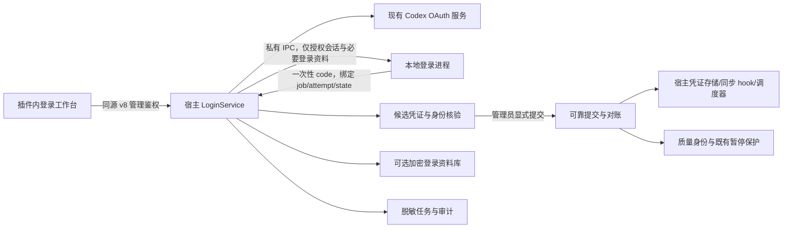
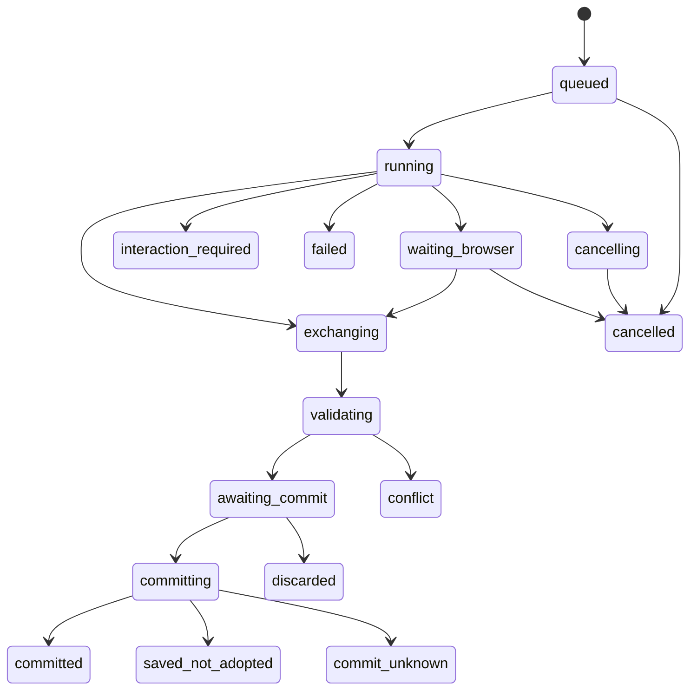

# 当前插件接入 OpenAI 2FA 登录的实施方案

状态：待实施设计，2026-11-14。基于 model-quality 0.3.0、宿主 quality capability v2 和已核查的固定参考源码。源码事实与证据见 [OPENAI_2FA_RESEARCH_CN.md](OPENAI_2FA_RESEARCH_CN.md)。以下新接口、类型、状态和文件均为拟新增内容，不能当成当前已有 API。

## 1. 设计结论

在当前插件增加“OpenAI 凭证登录工作台”，提供两种入口：

1. **浏览器授权**：复用 CPA 的 Codex OAuth；管理员在 OpenAI 页面完成密码、2FA 或其他官方交互。该方式作为兼容入口。
2. **本地密码 + TOTP 登录**：邮箱、密码、TOTP seed 在本机登录进程中使用，接入宿主创建的 OAuth 会话；由宿主兑换、核验、暂存和提交授权。它是本次新增能力的核心，不能只交付浏览器链接就称完成 2FA 登录。

两种入口都先生成候选结果，再由管理员确认导入或更新。默认不保存密码/TOTP；可单独选择加密保存，供以后**手动**重登。登录操作与质量检测采用不同任务、队列、状态和预算。

产品保持两个主页面：手动测试、质量运维。登录工作台从质量运维的“凭证状态”进入，不重新改造为通用账号管理平台。需要选择账号时复用当前目标查询结果，不创建账号分组。

关键边界：**登录成功只意味着授权获取或凭证更新成功，不表示质量通过、推理验证成功或恢复业务。** 不自动调用模型，不自动释放质量暂停，不启用规则，不清原生冷却。

## 2. 本期范围

| 纳入 | 明确不随登录功能引入 |
| --- | --- |
| 单个与小批量首次登录 | 自动注册 OpenAI 账号、自动添加密码 |
| 指定真实 auth_id 的同身份手动重登 | 改密码、开启/关闭/轮换上游 2FA |
| 浏览器授权与本地 password_totp | 默认第三方远端重登服务、上传账号给 Session Studio |
| 异步状态、取消、候选预览、显式提交、幂等 | 401/429 自动重登或自动恢复质量暂停 |
| 可选宿主加密登录资料 | Web Session/Cookie 导出、明文密码/TOTP 导出 |
| 同账号并发限制、身份和版本 CAS | BPS/Excel、SIWC、PAT、Agent Identity |
| 鉴权、审计、重启对账、运行时能力检查 | 自动解验证码、购买手机号、切换代理重试 |

本期首先支持 standalone 文件型 Codex OAuth。配置 API Key 不能通过 2FA 改造成 OAuth；runtime-only、插件虚拟凭证、同源子凭证、Home、未证明可可靠提交的远程 store 返回 unsupported。保留其原有质量观察能力。

社交登录、通行密钥、短信、邮箱 OTP、设备验证或安全挑战不伪装成 TOTP 成功：本地模式结束为 `interaction_required`，由管理员另行选择浏览器授权。不会自动换引擎或重发登录。

## 3. 架构与所有者



**秘密直接提交宿主管理路由。** 嵌入 UI 使用已有页面内存管理密钥，同源访问下文的 `/v8/management/credential-logins/...`。这不是插件服务端保存密钥再发回环 HTTP。当前质量接口继续走插件 v8 前缀。

这样密码/TOTP 不经过插件的 Management RPC、quality.Run、quality.db 或模型调用参数；UI 输入后仍短暂持有秘密，不能声称浏览器完全不接触。登录资料只传给宿主和受控本地登录进程。

不为此增加一个可让后台插件任意写凭证的通用 `host.auth.save` 包装。宿主可以提供只读登录能力摘要；真正的 start、commit、vault 写入必须通过当前有效的 management 鉴权请求。原生插件卸载时，宿主根据真实实例归属取消未提交登录任务。

| 状态/数据 | 唯一权威所有者 |
| --- | --- |
| OAuth state/verifier、code、候选 token、会话取消器 | 宿主 LoginService |
| 子进程、运行包、attempt 和进程树回收 | 宿主 LoginRuntime |
| 持久 task、幂等映射、commit intent/receipt、登录审计 | 宿主 `credential-login.db` |
| 可选 password/TOTP 密文与 key | 宿主 CredentialVault |
| 已提交 OAuth token | 宿主现有 auth store |
| 质量暂停、身份 incarnation、旧动作墓碑 | 宿主现有 quality 权威状态 |
| 手动测试、质量规则、结果、用量 | 插件现有 quality.db，schema 2 不变 |
| 页面状态、输入和候选摘要 | 浏览器内存，不写 local/sessionStorage |

新增宿主登录库独立 schema 1，避免升级 quality.db 后旧插件不能读取。不能因此声称降级旧宿主安全：原有质量暂停回滚约束继续适用。

## 4. 本地登录进程必须如何改造

toSub2 原程序是完整 CLI，会自行生成 PKCE/state、交换 token、写 Session/导入文件，不能直接作为生产 Worker 使用。

建议保留固定 MIT 参考，开发精简的本地适配程序：

- 宿主生成 authorization URL、PKCE challenge/state、固定 client/profile/scope/redirect；verifier 只在宿主内存。
- 本地进程接收宿主会话，不重新建立另一组 PKCE。完成密码/TOTP 后，沿该授权会话取得 callback code 即停止。
- 固定 `profile=codex`；callback redirect、state、job、attempt 均由宿主核验；一次性消费 code。
- 不调用原 `buildSub2apiOauthExport` 或 `exchangeOAuthCode`；不创建 oauth.json、cookie/session/checkpoint 文件；不返回 token 给插件 UI。
- 不执行添加密码、setup-totp、账号资料自动创建、手机号绑定、外部邮箱/短信服务。遇到额外交互返回明确的终态。
- 代理在任务开始冻结，来自宿主选定配置；没有凭证级配置时显示使用宿主默认或直连。首期不接收任意代理 URL，不继承工具自己的代理模板，不自动切换出口。
- 默认一次登录尝试；密码/TOTP 拒绝即终止。TOTP 生成使用可注入时钟，明确 Base32、SHA1/30秒/6位支持范围，既不枚举相邻窗口反复尝试，也不把 seed 显示在进度中。
- 通过继承的匿名管道或私有 IPC 帧传秘密，不用 shell 拼接，不放 argv，不把宿主管理密钥传给子进程；继承环境采用白名单。
- 始终验证上游 TLS；本地代理不意味着可以忽略证书错误。IPC 采用长度前缀和有限帧大小（进度4 KiB、总缓冲64 KiB），超限立即取消并回收进程；JS Promise超时不等于Python网络已取消。
- 结构化进度只允许固定 stage/reason、任务 ID、elapsed；不保留原始 stdout/stderr、HTML、重定向 query、Cookie 或响应体。
- 宿主验证 runtime manifest、平台、文件 hash 和实际能力。只认 `external_authorize_session + callback_code_only + bounded_cancel` 完整能力；只有原始 token 导出能力的程序不能冒充支持。

sub2api adapter 依靠固定源码字符串替换完成插桩，维护脆弱。新适配优先把所需流程封装成明确函数和独立入口；如必须保留补丁方式，构建期应用并核验文件 hash，不能在每次登录时临时猜测上游源码布局。

本机 macOS arm64 需要独立测试 Node→Python→curl_cffi 依赖及退出路径。sub2api Linux 运行包不能直接放进 macOS dylib；动态库仍为 Go c-shared，登录进程作为可选独立运行资源。

## 5. 任务状态与取消



`phase` 另列 starting/password/mfa/workspace 等进度，不能把每个网络阶段都做成可恢复任务。所有非提交中的活动态都可过期；重启后未证明完成的任务标记 interrupted，不自动重发。`committing`、`saved_not_adopted`、`commit_unknown` 由宿主启动对账，不重新登录、不重复 exchange。

任务字段至少包括 job_id、revision、owner_plugin、owner_instance、boot_id、attempt、method、intent、target_auth_id、expected_identity_version、registration_epoch、policy_fingerprint、principal_key、created/expires_at、phase、error_code、candidate_id、commit_id。原始 email、password、seed、OAuth URL/code/token 均不进入普通任务记录；展示用 masked_email。

默认建议：全局登录并发 1，可配置上限 2；同身份/同 auth_id 并发 1；等待队列 16；浏览器授权及密码任务总有效期 15 分钟，候选确认期 5 分钟。上游更短的有效期优先。期限是凭证获取阶段的限制，符合 CPA AGENTS 的认证例外，不能进入模型执行链路。

每账号建议最多 3 次手动尝试/小时，超限返回 retry_after；同一任务不隐式重试。可配置的限制需在宿主服务端执行。

登录库也必须有界：建议脱敏终态任务保留 30 天、审计 90 天、已完成幂等记录和无引用 receipt 至少 30 天，总容量默认 256 MiB。过期幂等键不承诺永久去重，客户端不能用超过保留窗口的 key 自动补发。未完成 intent、未解决冲突、有效 fence 和仍被引用的 receipt 不按普通 TTL 删除；容量不足先清理符合条件的终态记录，仍不足则拒绝新任务，保留取消与对账所需的预留写入空间。bbolt 清理记录不会自动缩小文件，压缩需停写并原子替换，不能用删除数据库代替维护。

取消必须区分：

- 提交 gate 之前：取消 session context，关闭 IPC，终止整棵子进程树并等待退出后才释放槽位。迟到 attempt 输出拒绝。
- 提交 gate 之后：返回 `committing`，UI 显示“提交中，等待确认结果”；不能返回“已取消”后实际写入。
- 对上游已收到的登录/授权请求无法回滚；取消保证本地不再采用晚到结果，不承诺撤销上游已创建会话。
- 断开管理页面不自动取消宿主任务；重新连接可查看其脱敏状态。插件停用/热重载取消该实例未提交任务，保留提交对账记录。
- 新实例不继承旧 callback 权限。后台只使用宿主自己的 job/attempt continuation，不保存任何过期 management RPC callback ID。

## 6. 候选验证、提交与跨存储一致性

### 6.1 身份核验

候选由宿主向固定认证端点的 token exchange 得到。解析 ID/access token 的明确 account/workspace/user/email，检查 token 间冲突及支持的 client/profile；不把任意上传的 JWT、Worker metadata 或输入邮箱当认证证明。当前 CPA 解析不是新增的签名验证；如果后续增加 OIDC/JWKS 验签，需要单独核验对应 client 的真实 token 契约，不能口头声称已具备。

重登必须匹配原稳定账号和 workspace，缺少必要身份就拒绝更新。新导入的身份信息不足时不能可靠去重，也不能提交；保留 `identity_unverifiable`。

首次导入在预览和提交两处按真实 principal 去重，不以 email 或文件名作为唯一依据。已有同 principal 的 auth_id 时返回 `duplicate_identity` 并提供脱敏引用，要求管理员选择已有目标重登；禁止新建别名绕过旧凭证暂停。同 principal 的多个已存别名不自动合并。

### 6.2 预期版本

启动绑定当前持久 identity_version、同进程 registration_epoch、存储来源、provider/profile 和目标政策快照。提交在 per-auth mutation gate 内重新检查。

正常 refresh 保留 incarnation，可合并最新 token 状态；另一次显式授权、删除重建、源定位变化或相关政策修改必须冲突。Generation、UpdatedAt、disabled 的同值、完整旧 token hash，都不能单独担当长期 CAS。

政策快照使用明确字段的规范 hash：来源/定位标识、provider/profile、身份绑定、代理配置、人工禁用意图及当前持有暂停的动作集合。它是新设计，不是假称已有 policy_revision。普通 usage、时间推进与 refresh 不改变快照。暂停/人工禁用在登录期间发生变化时，确认页重新读取并要求新预览，旧 commit 请求拒绝，且始终保留更严格限制。

### 6.3 专用可靠提交

拟新增 `CommitLoginCandidate`，复用宿主 token store、post-auth hooks、per-auth gate、文件锁、同步与缓存机制，但不直接调用会忽略持久化错误或清 cooldown 的普通更新路径。

提交步骤：

1. 当前 management 请求确认 candidate_id/revision、预期目标和意图，建立一次性 commit gate。
2. 写 durable commit intent：固定 commit_id、auth_id、旧身份、预分配的 next_identity_version、candidate 指纹、预期源和限制摘要；建立临时 commit fence，阻止同目标新执行在半提交阶段使用不确定授权。
3. gate 下核验最新目标，严格白名单合并授权字段，保留手动设置、模型配置、人工禁用、质量暂停、限流/冷却和其他 owner。
4. 经现有 store 的可靠写入路径保存，失败不得发布新运行态。首期文件 store 使用原子写/同步语义；未知 store 不假成功。
5. 以 commit_id 和旧身份为条件，将质量身份幂等 CAS 到 intent 中的确切 next_identity_version，再完成运行时采用和必要同步 hook/缓存通知。对账遇到已应用的相同版本直接确认；不能再次调用每次生成新 UUID 的普通 replaced=true 路径。只有保存、身份状态与运行时采用均确认后写 receipt 并去除临时 fence。
6. 浏览器收到 `committed` 和真实有效状态；独立“保存登录资料”失败显示 `credential_committed / vault_save_failed`，不能让管理员因错误重做已经完成的 OAuth。

旧 grant 对应的 RequiresSignIn/拒绝token标记与配额/质量限制分开：只能在确认新grant已被可靠采用后，按宿主已有凭证语义更新旧grant的认证失败记录。新授权的 InferenceVerified 必须为false；不能把旧授权的推理验证标记继承为新授权证明。

不能把 auth store、质量库、登录库称为一个原子事务。启动必须先加载未完成 intent/fence，再放行凭证：

- 源数据仍等于旧指纹：确认未提交；candidate 丢失则 interrupted，不重新授权。
- 源数据等于候选指纹：仅补做身份/采用/receipt 对账，不重做登录。
- 源数据为第三种值：commit_unknown/conflict，维持阻断，交管理员处理。
- 不盲目把磁盘改回旧 token；新的 refresh token 可能已经生效，回写旧值可能破坏凭证。

临时提交 fence 是窄范围的一致性保护，不是质量 owner，不更改质量动作归属，也不为登录设计通用策略框架。

从 fence 生效到 receipt 完成，旧 refresh 的发布、文件 watcher 采用、其他管理凭证写入也必须检查相同 mutation gate/fence。旧 grant 的 refresh 结果在新 grant 提交后不得发布；watcher 只能将磁盘结果交给该 intent 对账，不能绕过未完成提交自行采用。启动阶段也先恢复这些写入约束，再启动 watcher/refresh 与业务调度。

## 7. 与质量暂停及身份换代的关系

允许管理员为已暂停凭证显式重新授权，但这只是认证维修：宿主登录服务硬性禁用 VerifyInference、任何 host.model 调用与质量测试。不能通过 request body 开启“登录后测试”。

遵循当前宿主语义：普通 refresh 保留质量 incarnation；显式重登新 grant 形成新 incarnation。已有暂停仍按同一个 auth_id 阻断，不能将它当成失效记录删除。

重登后显示：

> 授权已更新。质量暂停仍有效，检测规则保持停止。当前尚未进行任何模型质量测试。

普通插件动作若因旧 identity 发生释放冲突，显示“旧授权对应暂停，需宿主管理员处理”，独立使用既有宿主管理入口查看并按完整旧动作 CAS 释放。UI 可在工作台旁提供明确的人工处理入口，直接调用既有 `/v8/management/credentials/quality-pauses` 及 `/release`；登录 commit 权限本身不授予释放权限，不自动调用它们。若另一个 owner 仍持有限制，继续展示不可用。

重登涉及的质量规则在提交前停止并使旧排队证据失效，提交后保持停止。为避免只靠下一次轮询，拟新增窄范围原生控制回调 `credential_login_prepare`：

1. 管理员点击commit后，宿主先持久化commit intent/fence，再向当前model-quality实例发送job_id、auth_id、expected_identity、preparation_id。此回调不携带secret。
2. 插件在一个事务中停止依赖该凭证的规则（包括control/judge）、清零连续计数、使旧版本证据失效，然后取消相关评测operation并确认本地worker退出，返回幂等ACK。
3. ACK完成前不能开始凭证写入；不支持该契约的旧插件返回能力不足。等待ACK时不持有auth mutation锁，避免cancel/target查询与提交死锁。
4. fence期间，插件的任务准入和规则恢复均拒绝该依赖；宿主也阻止直接模型入口绕过。收到旧实例或旧preparation的ACK无效。
5. ACK后重新取得mutation gate并检查CAS，才继续提交。若取消/失败，规则仍保持停止；fence只在证明旧状态安全或新状态完成采用后移除，不自动恢复规则。

宿主拥有journal与fence，插件拥有规则事务；双方按preparation_id对账，不声称跨库原子。此回调只协调已获管理员授权的提交，不赋予插件获取密码、启动后台重登或释放质量暂停的权限。新增控制类型放公共`pluginapi/pluginabi`，适配实现留宿主，插件只依赖`/v8` SDK。

新账号默认人工禁用、没有质量规则；管理员通过独立的启用操作放行，不让新授权在候选确认之前接收业务。

已有生效的模型请求可以结束；新执行从临时提交 fence 生效时受限。对后台旧 refresh、重试、粘性和 WebSocket 后续轮次的约束必须有集成测试。

Codex OAuth 登录并不会扩展当前自动质量证据覆盖面。当前插件自动证据只验证了原生 OpenAI-compatible chat/completions；Codex 评测按其真实能力显示观察/证据不足，不能随登录功能宣称已支持自动质量处置。

## 8. 登录资料加密与秘密最小化

默认 `remember_credentials=false`。邮箱/密码/seed 只供本次已明确提交的任务使用；提交成功、失败、取消或超时清理引用。Go/JS GC 不提供不可恢复内存擦除保证，文档不做这种承诺。

启用保存是独立的管理员动作：

- 宿主生成随机 32-byte key，私有目录 0700、文件 0600，临时文件写全并 fsync 后无覆盖发布。
- AES-256-GCM 随机 nonce，AAD 绑定 vault_record_id、最终 auth_id、profile、字段名、schema/key version。
- 密文保存邮箱、密码和 TOTP seed；外部读取只返回 masked_email、has_password、has_totp、updated_at、revision。
- key 不进入 quality.db、配置导出、前端、日志和子进程环境。已有密文但 key 丢失/损坏/权限过宽时关闭密码登录能力，不生成替代 key。
- 不提供秘密原文 GET/导出。编辑支持空值保持、显式 clear 删除；空字符串不能误覆盖有效 secret。
- 同时备份密文库与 key，恢复先校验 key ID。删除数据库记录不是可证明的物理擦除；bbolt 空闲页与备份仍应按敏感材料管理。
- 保存资料不创建定时重登任务、不启动巡检、不更改现有质量规则。

所有登录路由 `Cache-Control: no-store`；日志 middleware 必须按路由禁止 body/header/响应体捕获。动态错误只返回固定枚举，不依赖正则脱敏原始 Worker 日志。

## 9. 拟新增 API

统一前缀：`/v8/management/credential-logins`，复用宿主 management middleware、remote-access 与 Home 控制。精确路由；ID 放 query/body。所有 GET 只读。

| 方法/相对路径 | 作用 |
| --- | --- |
| GET `/capabilities` | method、runtime版本/平台、vault状态、禁用原因；不启动或下载进程 |
| GET `/targets` | 可更新的脱敏凭证、can_login/can_update、来源限制及暂停 |
| POST `/start` | 创建单个会话，202 + job_id；browser返回授权URL，本地方式接收秘密 |
| GET `/jobs` | 脱敏任务分页，limit默认20、最大100；稳定cursor |
| GET `/detail?id=...` | 查询阶段、结果、保存/采用状态；不返回token/code/seed |
| POST `/callback` | 远程浏览器手工提交callback；严格校验，敏感URL不持久化 |
| POST `/cancel` | 幂等取消；已进入commit则返回committing |
| GET `/candidate?id=...` | 候选脱敏身份和准确动作预览 |
| POST `/commit` | candidate revision + 预期身份 CAS，提交或返回原receipt |
| POST `/discard` | 释放未提交候选，不修改上游账号 |
| GET `/vault/status` | 只返回是否就绪 |
| POST `/vault/initialize` | 独立幂等初始化，不启动登录 |
| PUT `/vault/entry` | 按revision保存/编辑已验证身份绑定的资料 |
| DELETE `/vault/entry` | 删除保存资料，正在使用时返回冲突，不删除OAuth凭证 |

所有写操作使用 `Idempotency-Key`。去重键绑定 owner/intent/目标和规范请求摘要；secret 参与摘要时采用宿主专用 HMAC，不保存裸密码 hash。相同 key 不同内容返回 409。正常 API 中没有 `verify_after_login`、`auto_restore` 或 `clear_cooldown` 参数，传入这类未知字段返回422。

`/start` 概念示例（省略秘密值）：

```json
{
  "consumer_plugin": "model-quality",
  "method": "password_totp",
  "intent": "reauthorize",
  "target_auth_id": "opaque-auth-id",
  "expected_identity_version": "opaque-current-identity",
  "remember_credentials": false,
  "credentials": {"email": "fixture@example.test", "password": "<input>", "totp_secret": "<input>"}
}
```

consumer_plugin 只是管理请求选择的归属，不能作为权限证明。宿主从已注册插件获得真实 instance ID；未加载、不支持或正在退出的实例拒绝 start。实际任务归属不能由请求 body 指定或覆盖。

限额建议：单任务 body 16 KiB；email≤320字符，password≤4096字节且保持原文，TOTP规范化后严格验证Base32，otpauth URI≤2048字节且仅支持totp、SHA1/6位/30秒。otpauth URI只本地解析，不访问其中任何URL。初版批量最多10行，前端每项单独start、每项单独结果，不宣称原子批处理；专用字段为主，批量格式必须拒绝有歧义的分隔符，不能默默截断密码。

关键错误：400 malformed、401/403权限、409 identity_changed/duplicate_identity/commit_in_progress、410expired、422unsupported_method/credential_source/unknown_field、429login_budget/queue_full、503runtime_unavailable/vault_locked/store_unavailable。Worker阶段另有password_rejected、totp_rejected、interaction_required、workspace_mismatch、cancelled等枚举；不把网络或429计为密码错误。

## 10. UI 流程

继续使用当前独立界面语言，不复制 sub2api 的账号管理页。

质量运维 → 凭证状态 → “添加 OpenAI 登录”或目标行“重新授权” → 独立工作台抽屉：

1. **选择方式**：浏览器授权 / 本地密码与2FA；展示实际runtime就绪状态。未安装时说明所缺能力，不下载运行包。
2. **输入与目标**：首次导入或指定auth_id；脱敏原身份、代理选择、暂停/人工禁用状态。TOTP seed字段使用密码控件，提示与六位验证码不同；默认不保存。
3. **过程**：排队、登录、二次验证、授权、核验；取消按钮显示真实状态。关闭抽屉可以后台继续，清空表单秘密。
4. **候选确认**：创建/更新哪个身份、保留哪些限制、是否保存登录资料；只有“确认导入/更新”会提交凭证。
5. **完成**：分开显示授权获取、持久保存、运行时采用、业务有效状态。质量暂停或人工禁用仍醒目显示。

批量列表只显示序号、masked_email、phase、结果和逐项操作；不在列表重显密码或 seed。完成项不因点击“重试失败项”重新登录，轮询断线继续原 job，不能补发start。JSON导出仅包含脱敏任务报告。

原页面密钥只驻留client.js私有内存；新增宿主请求客户端使用明确的同源路径白名单，不能接受由服务器错误文本或用户输入指定的任意API URL。401仍清空整个管理会话；不记录HAR中的敏感body。

## 11. 文件和模块边界

| 拟改动 | 职责 |
| --- | --- |
| `plugin/ui/login.js`、`login-view.js` | 工作台状态、任务轮询、候选/暂停提示；不与quality Run混合 |
| `plugin/ui/client.js` | 同源宿主登录请求、复用内存鉴权与断连取消 |
| `plugin/ui/index.html`、`style.css` | 两页内入口、独立抽屉与响应式布局 |
| `plugin/cmd/model-quality/main.go` | 扩展精确静态资源白名单与窄范围原生控制分发；不承担密码/OAuth业务 |
| `plugin/quality/login_prepare.go`、原生控制适配 | 幂等停止依赖规则/取消评测并ACK；不处理secret，不执行登录 |
| `workspaces/CLIProxyAPI/internal/authlogin/` | 统一会话、候选、核验、IPC、运行时和vault服务 |
| `internal/api/handlers/management/credential_logins*.go` | 鉴权HTTP适配与固定错误码 |
| `internal/api/server_management_v8.go` | 注册新v8登录路由，不修改v0 |
| `internal/auth/codex/` | 复用PKCE/token exchange，必要的会话context接口提取 |
| `sdk/cliproxy/auth/login_commit*.go` | mutation gate、可靠提交、状态保留与身份对账 |
| `internal/pluginhost/` 生命周期接点 | 真实owner_instance绑定、卸载取消与规则停止协调 |
| `sdk/pluginapi/types.go`、`sdk/pluginabi/types.go` | 窄范围prepare/ACK控制契约，保持旧插件兼容；不开放原始token写入接口 |
| `login-runtime/` | 独立本地进程源、锁定依赖、适配和平台构建脚本 |
| `host-patches/` | 新宿主源码补丁、基线和能力说明；原参考不改 |
| `docs/`、`artifacts/` | 安装、API、数据/回滚文档、动态库/runtime与离线材料 |

具体包依赖需在实施时防止internal/authlogin与sdk/auth形成循环：底层提交接口由Manager公开为窄Go接口，宿主authlogin注入调用；插件module不import宿主internal。

继续使用moego/ojson、moego/base64，Go JSON变更在Doc上完成后统一序列化；不改thinking/payload屏障，不新增供应商模型执行器。日志使用logrus且只记录固定code，代码注释英文。

## 12. 实施顺序与完成条件

| 阶段 | 具体工作 | 交付判据 |
| --- | --- | --- |
| A：可信边界 | 固定runtime裁剪、code-only适配原型、Host LoginService接口、来源能力矩阵、专用commit设计 | mock授权码可由CPA既有交换器接收；worker不能自行换token或改2FA |
| B：宿主核心 | session/attempt/cancel、候选、身份去重/CAS、提交journal/fence、暂停保持、重启对账 | 写失败/崩溃/删除重建/旧refresh等故障注入通过 |
| C：本地2FA | TOTP/进程IPC、超时/取消、错误枚举、代理冻结、可选vault与丢钥匙保护 | 离线密码/MFA/额外交互/错误路径与秘密扫描通过 |
| D：插件工作台 | 两种方式、进度、取消、预览/提交、重登、批量、旧暂停人工处理 | 浏览器完整流程可操作，所有敏感操作均真实调用宿主 |
| E：发布 | 两module验证、共享库/runtime构建、安装升级回滚、原生加载E2E | 可复现macOS arm64交付；其他平台独立验收后列支持 |

可以先实现浏览器方式来验证宿主核心，但本地password_totp未通过之前，只能标为“浏览器授权阶段完成”，不得描述为“2FA自动登录已完成”。

新增 `credential_login` 独立能力版本1，不把quality v2虚假升级为已经具备登录。旧quality v2宿主仍可使用现有测试/质量功能，登录入口明确显示能力不足。插件版本建议0.4.0；最终版本号在正式交付时确定。

## 13. 必须覆盖的验收

| 类别 | 核心断言 |
| --- | --- |
| 无副作用 | 安装、打开工作台、GET能力/状态、保存设置不发起登录或模型请求 |
| TOTP | RFC向量、固定时钟、窗口边界、非法seed、参数不兼容、错误码不是网络错误 |
| 协议作用域 | worker使用宿主state/challenge，callback一次消费；无token交换/Session导出/改2FA路径 |
| 身份 | 错账号、同邮箱不同workspace、token字段冲突/缺失、sid与workspace区别、重复principal拒绝新别名 |
| 并发 | 同账号互斥、正常refresh不误冲突、另一登录/删除重建拒绝旧结果、旧refresh/watcher/管理写入不能绕过提交fence |
| 限制保留 | 人工禁用同值修改、冷却/限流、其他owner、新质量暂停全部保留；不调用reset_cooldown |
| 暂停中登录 | 可显式取得新授权，但模型调用数为0；业务/手动测试/control/judge/WS后续轮次仍拒绝；规则停止 |
| 提交 | auth写失败不发布、quality库写失败、receipt写失败、崩溃前后journal/fence恢复、重复对账不再次换身份、saved_not_adopted不假成功 |
| 取消 | 排队、密码前、MFA中、exchange中、候选、commit竞态；重复cancel；进程树真退出后释放槽位 |
| 幂等 | POST响应丢失后返回原job，重复commit返回receipt，不重复兑换code；相同key不同body冲突 |
| 生命周期 | 页面关闭、401、插件热重载/卸载、host restart、runtime进程崩溃、旧attempt迟到、队列满、容量不足拒绝新任务且保留未完成对账 |
| vault | 原子初始化、并发初始化、缺key/损坏/权限、AAD不符、cipher篡改、保存失败、备份恢复、不返回secret |
| 安全 | 管理权限/remote-access/Home、secret不进日志/URL/argv/env/导出/quality.db、未知字段、runtime hash不匹配 |
| UI | 明暗/移动、批量逐项状态、错误保留非秘密输入、断连清空、候选与可用状态分离、明确人工释放 |

离线采用fake auth provider和fake worker：被测域名/URL替换只能由测试依赖注入，不能作为线上UI参数。时序测试使用可控时钟和显式屏障。至少在一次真实宿主+c-shared+浏览器流程中统计auth与model请求：登录只产生auth流程，model计数必须为0。

分别执行插件与宿主 `go test ./...`、相关race、gofmt/vet，宿主要求的test-output编译检查、实际c-shared构建、runtime自检和前端交互验证。平台“已通过”必须对应真实运行，不能由Linux包存在推断macOS或Windows支持。

真实OpenAI验证只用于另行明确选定的测试账号：不轮换2FA、不改密码、不自动探测模型，且结果仅证明该次账号/网络/流程。日常测试不使用真实账号额度或生产登录资料。

## 14. 升级、卸载、回滚和当前未决点

升级保持原始CPA参考目录只读，只更新工作副本补丁；保留quality.db/quality-state.db。安装runtime是明确操作，不在打开页面时下载或运行。发布包记录源commit、许可证、依赖版本、平台和SHA-256，不以任意“latest”替换已验证程序。

停用插件：停止接单并取消未提交任务；已经committing的任务由宿主完成对账。保留宿主人工释放暂停入口、登录审计和已保存凭证；不随卸载删除vault key或数据库。

回滚登录功能：先排空/取消任务并解决所有commit_unknown，备份auth store、登录库和vault key，禁用runtime，回退到仍识别quality v2暂停的已验证宿主。旧0.3插件忽略新增登录库；不得通过删除key/DB解决不兼容。回滚不识别质量暂停的宿主仍必须执行原有rollback_guard流程。

当前已解决：固定toSub2源码及MIT许可可取得，主协议blob与sub2api adapter匹配。

仍需实施验收的真实问题：

- toSub2没有符合本设计的host-owned PKCE/code-only入口，需要实作并证明不会绕回原token导出流程。
- 宿主现有OAuth handler不能直接提供可靠提交、完整取消与暂停状态保留，需要提取服务并加入故障对账。
- macOS登录runtime尚未构建验证，Linux参考包不能当当前插件的可安装运行资源。
- 非公开网页协议当前在线可用性未知；官方文档读取被403阻挡。本轮不能给出成功率或“长期稳定”的承诺。

这些是明确的工程工作项，不是要求管理员先交出账号或关闭2FA的前置条件。方案阶段没有修改当前登录、质量暂停或UI的运行行为。
