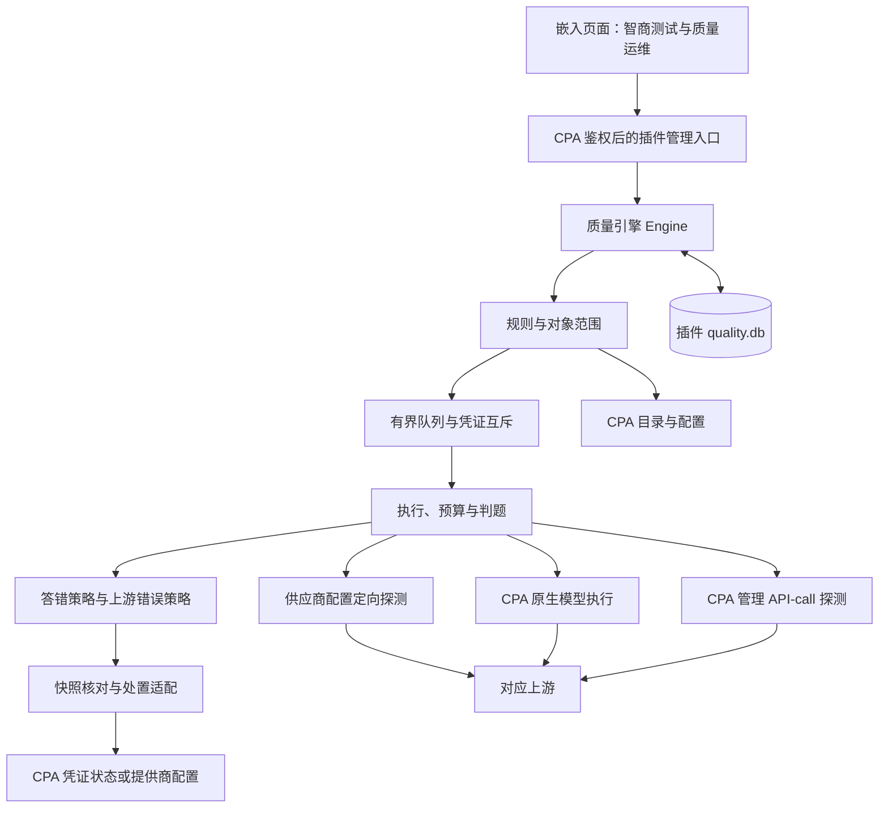

# 质量运维架构、实现现状与修复边界

核对日期：2026-11-21。工作区源码版本：插件 `0.29.37`，嵌入 UI `13.6.60`。Git 基点为 `dd50c3d625f17639e92a7cd6c01ead6ecffe47ce`，本次分析包含工作区已有的未提交修改和新增文件，不能只用该提交复现本次源码状态。

本文记录源码审查结果和建议的修复架构。产品规则、用户决策及场景验收见 [质量运维逻辑说明](QUALITY_OPERATIONS_LOGIC_CN.md)。标为“目标”或“建议”的内容尚不能视为已实现、已测试或已部署。

## 1. 系统边界

CPA 负责凭证、提供商配置、模型目录、业务路由与实际启停。插件负责规则、检测任务、答题结果、凭证错误分类、普通处置记录和授权范围内的管理接口调用。

质量运维没有接管 CPA 的业务路由。通过管理接口停用对象后，正常业务调用是否被路由到它，由 CPA 当前配置和运行时决定。插件不应以历史普通停用记录额外维持一层永久业务禁用。

官方宿主公开回调不提供历史独立质量暂停及其归属释放能力。普通 `disable_credential` 与历史 `pause_credential` 是不同机制。保留历史归属与保护，不用普通停用模拟独立暂停，不修改官方 CPA 源码。

## 2. 实现模块

下表路径相对于仓库根目录，函数名用于定位，避免行号随工作区修改失效。

| 模块 | 主要职责 | 关键入口或类型 |
| --- | --- | --- |
| `plugin/cmd/model-quality/main.go`、`lifecycle.go` | 原生 ABI、管理路由注册、资源服务、用量回调、实例租约与关闭 | `engineRuntime`、管理与 usage 回调 |
| `plugin/quality/api.go`、`routes.go` | 鉴权后的插件接口分派、严格请求解析、分页响应 | `Handle`、`ManagementRoutes` |
| `types.go`、`engine.go` | 领域结构、能力、配置、实例状态、加载与重启 | `Engine`、`Rule`、`Run`、`Frozen`、`Target` |
| `rules.go`、`rule_schedule.go` | 规则增删改、版本、启停、Cron、单规则定时授权、结果决策入口 | `saveRuleLocked`、`setRuleTimer`、`decideLocked` |
| `rule_objects.go` | 对象分类、组授权、旧规则范围迁移 | `selectRuleObjects`、`validateRuleGroups`、`providerRuleProblem` |
| `scope_plan.go`、`scope.go`、`scope_skip.go` | 目录读取、候选范围、快照、准入、批次、未执行原因 | `collectScopeLocked`、`scopeAdmissionLocked`、`dispatchWithInventory` |
| `admission.go` | 手动测试校验、身份冻结、提交回执、持久入队 | 手动 `Submit` 路径 |
| `scheduler.go` | Cron 扫描、队列调度、worker、依赖互斥、usage 入队 | `Tick`、`claimRunLocked`、`worker` |
| `execution.go`、`questions.go`、`collector.go` | 样本执行、取消、响应完整性、题目冻结、判题 | `execute`、`DeterministicJudge`、响应 collector |
| `host.go` | 官方 SDK 目录与原生执行适配 | `NativeHost`、`Targets`、`Execute` |
| `management_client.go` | 进程内管理授权、文件凭证快照、API-call、状态与删除接口 | `CredentialSnapshot`、`executeManaged`、`SetCredentialDisabled` |
| `provider_directory.go`、`provider_targets.go` | 配置与运行时关联、路由身份、模型映射、停用组目录补全 | `providerDirectory`、`providerRoute`、`configuredTarget` |
| `provider_probe.go` | 使用当前配置构造定向请求、协议解析、机密过滤 | `executeProvider`、`probeRequest` |
| `credential_policy.go` | 普通处置归属、答错及错误动作、恢复、人工核对 | `CredentialDisposition`、`decideManagedLocked`、`admitSnapshotLocked` |
| `provider_disposition.go`、`provider_mutation.go` | 整组完整性、组归属、配置条件写入与确认 | `providerRoundVerdict`、`providerWriteSnapshots`、`setProviderDisabled` |
| `upstream_error.go`、`catalog_action.go`、`error_policy_disabled.go` | 上游错误分类、目录缺项动作、旧错误停用阻断 | `managedUpstreamCondition`、`errorPolicyDisabled` |
| `transitions.go`、`snapshots.go` | 执行复查、取消、原子提交本地状态、快照 | `checkExecution`、`commitLocked` |
| `store.go`、`budget.go` | bbolt、迁移、调用和 token 预算 | `Store`、`reserve`、`account` |
| `queries.go`、`metrics.go`、`result_limit.go`、`removed_credentials.go` | 历史投影、统计、保留和清理、已移除凭证核对 | `queryRules`、`metrics`、`clearRuleHistory`、`checkFinishedRounds` |
| `reconcile.go` | 历史独立暂停对账、保留与存储准入 | `Reconcile`；官方不具备独立暂停时不会执行该对账 |
| `plugin/ui/app.js`、`view.js`、`client.js`、`index.html` | 编辑、范围选择、刷新、结果展示、浏览器管理请求 | `editRule`、`loadOperations`、`providerRouteReady` |

## 3. 管理通道与调用路径

### 3.1 两种管理路径

插件业务接口注册在官方已经鉴权的 `/v0/management/plugins/model-quality/` 扩展通道。SDK 模块名中的 `/v8` 不决定插件扩展 URL。

插件调用 CPA 原有管理接口时使用 `/v8/management/...`。静态页面由资源通道服务，不在公共资源 GET 中执行业务变更。

| 插件接口组 | 功能 |
| --- | --- |
| `/targets`、`/questions`、`/presets` | 对象、题目与预设 |
| `/runs`、`/runs/detail`、`/runs/cancel`、`/runs/review` | 手动提交、查询、取消、人工评审 |
| `/rules`、`/rules/run`、`/rules/pause` | 规则配置、立即执行、规则启停 |
| `/rules/timer`、`/rules/scheduling` | 单规则定时与兼容的全局调度控制 |
| `/rules/question-preview`、`/rules/scope-preview` | 题面和范围预览，不发起模型请求 |
| `/rules/handling/acknowledge` | 当前实现的人工处置核对，现状会停止规则 |
| `/runs/history`、`/rules/run-history`、`/history`、`/metrics` | 手动与规则历史清理、审计和统计 |
| `/actions/preview`、`/actions/release` | 历史独立暂停接口，受宿主能力限制 |

完整方法与路径以 `ManagementRoutes` 为准；上表没有增加新接口。

### 3.2 三条模型请求路径

| 路径 | 主要使用场景 | 证据及限制 |
| --- | --- | --- |
| 原生 `host.model.execute` / `execute_stream` | 手动智商测试、通常的纯观察规则、未授权整组写入的供应商观察 | 由 CPA 处理原生路由与协议转换；官方回调没有历史独立暂停要求的可信最终 payload 证明 |
| `/v8/management/requests/api-call` | 受支持的 OpenAI / Codex 文件凭证管理探测及停用中复检 | 精确绑定 `auth_index`，使用 `$TOKEN$` 替换；证据路径 `cpa_management_probe` |
| 提供商配置定向 HTTP 请求 | 授权处置、停用配置组检测和恢复 | 核实配置与映射，密钥只用于后端请求；证据路径 `provider_config_probe` |

原生调用成功不保证相同参数的定向探测可执行。当前部分 Claude、Gemini、Interactions、Vertex 提供商的显式思考强度需要 CPA 原生转换，定向探测会报告不支持。配置缺少可核实的 URL、模型映射、身份或安全请求头时，也可能无法探测。

提供商原生与定向输出均需避免泄露读取到的敏感配置。配置探测会检查返回模型与上游映射的一致性。管理探测证据不会被伪装为 CPA 业务最终 payload 的可信证明。

### 3.3 普通启停接口

文件凭证状态通过 `PATCH /v8/management/credentials/status` 修改，删除通过带文件名的凭证删除接口完成。文件凭证不支持原子条件状态写入或条件删除；写前、写后核对不能消除最后检查与实际写入之间的并发窗口。

供应商按能力使用单路由 `excluded-models` 通配项或 OpenAI 兼容配置组的 `disabled`。恢复时保留原模型排除内容。配置写入使用官方提供的强 ETag 与 `If-Match`，冲突不盲目重试。写后还要核实配置与运行时一致。

供应商配置删除当前不受支持。明确整组授权与完整组检测条件不能由“选择全部对象”隐式替代。

## 4. 数据模型与权威来源

| 数据 | 表达的事实 | 权威来源 |
| --- | --- | --- |
| `Target` | 本次读取的对象身份、启停、目录、运行状态与能力 | CPA 目录、配置及插件的只读投影 |
| `Rule` | 对象类型、范围、检测计划、两类策略、恢复及调度授权 | 插件持久配置 |
| `Frozen` | 本轮规则版本、题面、参数、身份、模型、样本、快照 | 派发时冻结，执行时复查 |
| `Run` / `Sample` | 执行状态、回答、质量判定、错误证据、处置结果 | 本轮实际执行 |
| `CredentialDisposition` | 普通操作意图、结果、规则归属和当时快照 | 插件本地记录与 CPA 写后确认 |
| 历史 `Action` | 独立质量暂停归属 | 历史宿主机制和保留记录，不能与普通停用互换 |
| 审计与回执 | 发生过的操作、提交去重关联 | 插件持久记录 |

`ManualDisabled` 是现有字段名，主要投影 CPA 的 disabled 状态。仅凭该字段为真，不能认定最后一次停用一定由管理员执行。普通处置归属来自独立记录。

启用、有效可用、是否存在历史错误、是否允许本规则恢复是不同维度。`RuntimeStatus=registered` 是供应商可能的合法状态，不能在一个入口被视为可用、另一个入口又只因状态名不同而拒绝。

本地数据库 `quality.db` 使用 bbolt，目录权限 `0700`、文件权限 `0600`，单实例打开。桶包括 `meta`、`runs`、`rules`、`audit`、`usage`、`idempotency`、`presets`。普通处置记录与定时授权保存在 `meta`，不是 CPA 独立 owner。

`commitLocked` 先在一个 bbolt 事务中提交相关本地状态，再更新引擎内存。CPA 写入与插件数据库不在同一事务中。

## 5. 调度、执行与持久化顺序

1. 新建或修改规则校验类型、范围、计划、策略和权限，更新 revision。预览不调用模型。
2. 后端每秒检查定时计划。五段 Cron 使用服务端时区；旧间隔及时区配置保留兼容处理。
3. 定时需要规则自身可运行、`SchedulingEnabled` 有效，以及旧全局开关或该规则单独定时授权。显式关闭全局调度会撤销单独授权。
4. 到期时先推进下一次时间，再派发本轮。重叠和错过的周期不作为积压任务逐一补跑。
5. 动态读取目录，按范围展开。同一次到期扫描可共享目录读取；新对象在下一次匹配轮次加入，不追加到已冻结批次。
6. 保存批次、各对象任务与冻结计划，放入有界队列。批次使用一个轮转队列入口，展开中的待执行对象另有上限。
7. worker 一次性预留主体、判题和对照的全部凭证依赖。冲突任务继续排队，不占用 worker 等待凭证锁。
8. 执行前及每份样本前复查规则版本、取消、身份和限制。先持久记录预算预留，再发送请求。
9. 解析完整性、质量判定与上游错误。完整轮次结束，或符合错误处置条件提前结束时，进入规则决策。
10. 写入前再次检查当前规则、快照、证据与整组授权。先持久保存操作意图，再调用 CPA，最后保存确认结果或待核对状态。

已建立的原生流可关闭。官方非流式回调及流建立之前的调用不提供同等的立即取消保证。取消后晚到的结果不得成为新的处置依据。

当前队列满时，动态派发可以返回带 `queue_full` 未执行项的批次回执，并不总是使整个 API 请求报错。文档和界面应区分“收到派发请求”与“已经开始模型调用”。

## 6. 默认值与统计口径

以下为当前源码默认值，不代表建议修改：

| 项目 | 当前值 |
| --- | --- |
| 新规则对象与范围 | OAuth 账户、仅已启用 |
| 题目与模型 | `logic-candy`、`gpt-6.2-sol` |
| 思考强度与样本 | `high`、每模型 1 份 |
| 答错动作 | 仅检测 |
| 上游错误动作 | UI 在支持处置时四项预选停用；API 新建省略字段时不自动补入这些动作 |
| 自动恢复、定时 | 默认关闭 |
| Cron | `*/30 * * * *` |
| worker、队列入口 | 2、32 |
| 模型与主测样本上限 | 默认 8 个模型、32 个样本；每模型 1–8 份 |
| 输出与响应限制 | 配置最大输出 4096 token、响应默认 262144 字节；单次请求实际输出限额见冻结参数 |
| 每日预算 | 200 次调用、1000000 token；预算日按 UTC |
| 历史与存储 | 通用保留 30 天、存储准入阈值 128 MiB；新规则另默认每对象保留 100 条结果 |

答错仅检测与上游错误预选停用属于独立策略组合，不构成逻辑冲突。UI 与直接 API 的创建默认值不同，应明确展示来源，不因文档任务擅自改动。

自动答错处置使用完整轮次，不沿用历史独立暂停的默认三轮失败阈值。历史 `FailThreshold` 仍存在，不能据此推断普通停用等待三轮。

质量统计采用已存储 `QualityVerdict`，不会因为手动展示字段 `AnswerMatch` 或人工 `Review` 显示正确就自动改写。通过率分母是明确正确与错误样本，覆盖率另统计已判定的计划位置。预检、跳过与已清理历史不混入有效答题统计。

官方 usage 回调缺少完整来源归因，入口当前写入 `unknown`。这些执行尝试统计不能被当作已精确区分的用户业务请求数。

## 7. 重启、认证和历史清理

管理适配器授权保存在后端进程内存。插件重启后，需要新的已认证面板请求建立管理会话，之后关闭页面不影响已经授权的后端定时运行。浏览器的管理连接持久化是现有独立机制，不能据“后端内存授权”推断浏览器从不保存管理密钥。

普通供应商探测密钥不进入检测历史。账号登录模块的账号资料存储属于另一套功能，不在本次质量运维状态修复中改变。

启动会将旧 `queued/running` 任务记为 `interrupted`，不自动重发调用。未完成的普通写入进入待核对，不因重启重放。存储故障会阻止新的任务及处置，避免发生无持久记录的写入。

规则按每个对象分别保留结果，通常一份主测样本算一条，无样本的诊断运行也占一条，至少保存完整一轮。未确认处置及必要证据受保护。

当前“清空规则运行记录”作用于所有规则的可清理历史，即使页面正在筛选单条规则，也不是只清理筛选结果。它不改变 CPA 状态、规则定时和手动测试历史。

删除规则会清除其规则、普通历史和已确认关联，不向 CPA 发起启用。进行中写入阻止删除，未知结果保留隔离和必要证据。历史独立暂停有自己的删除限制。

## 8. 已核实的实现差异

| 编号 | 当前实现 | 与已确认目标的关系 | 定位 |
| --- | --- | --- | --- |
| C01 | 旧错误停用分支的前端手动测试检查只接受 `active` | 合法可用的供应商 `registered` 可被误拒绝；已用隔离输入复现用户报错 | `view.js` 中 `error_policy_block` 检查；与 `providerRouteReady` 对照 |
| C02 | `scopeMember` 和错误记录排除发生在当前状态校准前 | CPA 外部启用后仍可能退出所有规则 | `error_policy_disabled.go`、`scope_plan.go` |
| C03 | 已有 `observeEnabledTargetLocked` 主要在管理快照准入被调用，错误排除还先于该调用 | 不是各入口通用的外部启用校准 | `credential_policy.go` 的 `admitSnapshotLocked` |
| C04 | 文件凭证答错停用调用 `stopManagedRules`，关闭其他直接依赖规则；供应商路径不相同 | 普通对象停用不应永久改写用户规则启停 | `credential_policy.go`、`provider_disposition.go` |
| C05 | 人工核对结束普通关联时停止所属规则 | 不应成为手动启用后恢复正常使用的必经步骤 | `acknowledgeHandling`、`acknowledgeProviderGroupLocked` |
| C06 | `loadOperations(true)` 轮询规则、统计和活动，不同步 targets | 前端可能继续使用旧对象状态 | `app.js` 的 `loadOperations` |
| C07 | 测试明确要求外部启用后仍退出错误处置对象的后续检测 | 该断言与新目标冲突，需要在实现时同步更新 | `TestErrorPolicySuspensionsSkipEveryScope` |
| C08 | “全部”对本规则答错停用对象仍依赖恢复授权，其他规则归属也会阻止检测 | 用户已确认继续只读检测；本规则恢复关闭时不恢复，他规则可测但不接管恢复归属 | `scopeAdmissionLocked`、`recoveryDenied` |
| C09 | 已核实目录缺少一个模型时生成整个对象的目录检查运行，并可能处置 | 用户明确选择保留：应用模型不支持策略，本轮不检测其余模型；这是已确认行为，不列为待修复错误 | `firstMissingModel`、`queueCatalogRun`、`catalog_action.go` |
| C10 | `managedRule` 将答错动作与上游错误动作都归为处置规则，`validateManagedRule` 统一要求确定性判题且无对照 | 用户已确认上游错误处理不依赖标准答案，应拆分答错证据要求与凭证错误证据要求 | `credential_policy.go` 的 `managedRule`、`validateManagedRule` |
| C11 | 其他规则答错停用对象此前不能进入当前规则的普通探测，错误来源升级主要在原规则恢复分支处理 | 用户已确认 B 可发现新上游错误并停止 A 的恢复，同时保留 A 归属、B 触发证据且不重复写 CPA | `scopeAdmissionLocked`、`decideManagedLocked`、`decideProviderLocked` |

## 9. 目标架构建议：先核对当前状态，再做范围与权限判定

本节是实现方向，不是新增 API 或字段已经存在的声明。

### 9.1 正常状态读取中的本地校准

CPA 手动启用由 CPA 生效，主项目使用不依赖插件。这里的校准是正常请求中的自动状态同步，不是第二道启用审批，不增加“待插件核实”的用户流程、额外验证调用或后台解锁任务。

在手动提交、对象展示、范围派发及执行复查的合适位置共用同一套状态解释：

1. 读取可核实的 CPA 当前对象和必要配置，区分读取失败与真实停用。
2. 检查历史独立暂停、身份冲突及未知写入等仍须保留的限制。
3. 对已确认的普通停用记录，识别同一对象是否已经被 CPA 启用。
4. 若确认外部启用，仅结束普通记录的当前阻断和旧恢复归属，保存原因、关联和审计，不写 CPA、不调用模型。
5. 用校准后的状态判断对象是否属于范围、是否允许检测以及是否允许恢复。

状态读取可以用于核对错误停用对象是否已被管理员启用；“停用期间不再答题”不能继续解释为“永远不读取其启用状态”。需要有界读取和适当刷新，不建立每份历史记录的高频后台轮询。

手动测试提交和规则派发自身读取当前状态，不能要求用户先等待另一个核实任务或固定轮询周期清除旧普通记录。读取失败报告实际的管理连接、目录或身份问题，不能用历史错误停用记录代替 CPA 当前状态。正常身份与写入条件检查仍保留。

整组校准必须核实成员与组身份，在一致的本地转换中处理组记录，避免只清理其中一条路由而被另一条旧记录继续阻断。组成员变化不能当作原组已经完整恢复。

### 9.2 探测权限与写入权限

建议把准入结果明确分成候选归属、可执行性、执行通道、可恢复性和可处置性。用户已经确认全部范围中，本规则答错停用但恢复关闭的对象，以及其他规则答错停用的对象，都可以只读检测。只读检测资格不能隐式授予恢复、删除、接管归属或整组写入权限。

答错策略与上游错误策略分别消费本轮相应证据。共享底层快照和写入确认机制，但不得用“答错仅检测”覆盖上游错误策略。上游错误处置无需标准答案，自定义、视觉与人工评审题型也可使用支持的探测路径；答错自动处置继续要求完整明确的判题证据。

不能只删除规则保存校验：还要检查题目与参数准入、执行通道选择、样本错误提取、动作判定和 UI 可选项，保证独立错误路径实际可执行。官方宿主尚不支持的对照身份、LLM 判题或协议功能仍保持对应能力限制。

自动恢复仍只在答错动作选择普通停用时提供。恢复分支使用原规则的 Cron 或立即执行，不新增恢复定时器。

用户确认跨规则只读检测命中已配置停用的新上游错误后，停止整个对象的所有复检，包括原规则 A 的恢复。对象已在 CPA 停用，因此执行的是有新证据的本地处置原因更新，不重复发起 CPA 停用，不转移 A 的归属。需要分别持久保存原规则和动作，以及触发规则 B、运行、模型、错误与时间，不能依赖可能被清理的触发运行才能解释阻断原因。

该转换应再次核实当前仍停用、原归属与身份匹配、证据属于当前有效任务；整组情形核实原停用单位及成员。通过同一持久转换更新相关记录并阻止晚到的恢复写入。B 的该错误策略为仅记录时不执行上述转换。未知写入或历史独立暂停不能被新错误覆盖为普通已确认停用。

### 9.3 新一轮证据边界

外部启用被确认后，应通过状态代次、任务失效标记或等效机制，使旧停用期间冻结的任务与证据失去再次处置资格。具体字段和实现由开发阶段确定。

判定和写入前都要核实该证据仍属于当前规则版本及当前对象状态。一次人工启用不豁免新一轮明确错误；也不能允许旧错误在启用后立即重放。

CPA 不提供的原子性不能由插件文档承诺。如果启停变化完全发生在两次读取之间，且接口未暴露可区分版本，插件不能宣称必然观察到该变化。

### 9.4 规则状态与历史迁移

普通停用仅影响对象与本轮受影响任务，不永久关闭其他规则。管理员停止规则是另一条显式状态转换。

对于已经被旧代码自动关闭的规则，只有能够可靠证明停用来源且没有后续管理员停止操作时，才讨论修复原配置。证据不足时保留停止并提示，不批量启动历史规则。

已有旧规则的对象范围、整组授权、调度许可和历史独立暂停不能因升级、改名或目录发现而自动扩权。

## 10. 文档与验证状态

本次对话此前的源码审查已完成隔离的 `quality` / `ui` Go 包检查和 `scripts/test_question_test.mjs`，并通过实际前端函数的合成对象输入复现 C01。Go 检查使用临时模块文件，把缺失的本地宿主 replace 指向只读的 CPA 8.0.76 源码；仓库依赖文件未因此修改。

上述检查证明检查时工作区的既有行为，不证明本文件的目标架构已经实现。当前任务是编写逻辑与架构文档，不执行真实账号模型请求、启停或部署。本次文档核对包含本地链接、代码块闭合、18 项决策、7 项澄清和 31 项验收编号，以及范围矩阵、流程图与已确认答案的一致性。图表以 Markdown / Mermaid 源码提供。

旧 `ARCHITECTURE_REVIEW_CN.md` 描述的是历史独立暂停设计。旧范围、恢复和错误文档中“错误停用后不再核对状态”的内容应作为既有实现或历史行为阅读，不能覆盖本次已确认的外部启用要求。
