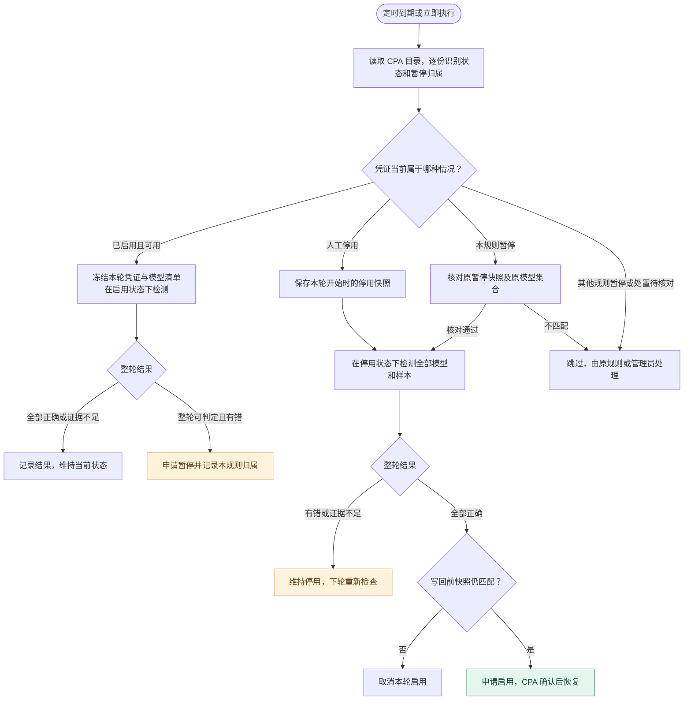
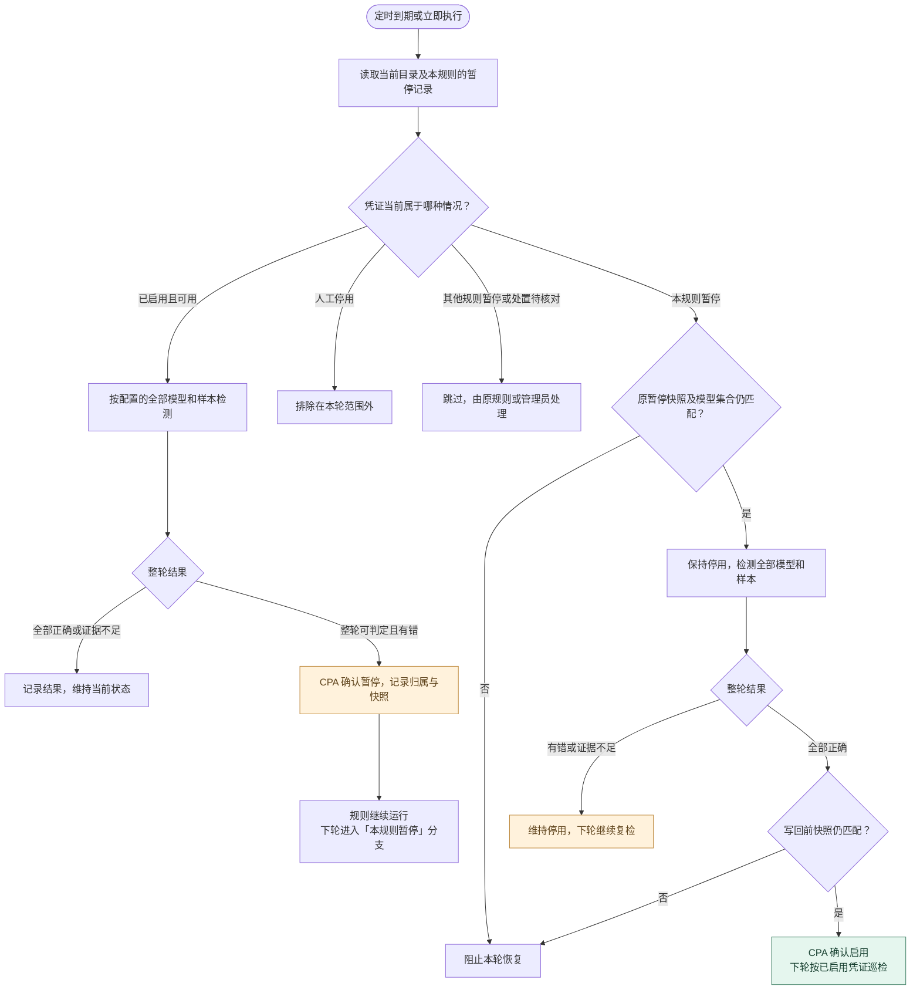

# 质量运维：两种检测范围如何暂停和恢复凭证

适用于插件 **0.29.19**、界面 **13.6.19**。两张图均以“答错后的处理”选择 **暂停凭证**、勾选 **整轮检测通过后自动恢复** 为前提。“启用”指 CPA 将该凭证的停用状态解除。图中的每一条路径都针对一份凭证。

## 一、全部凭证

管理员先在 CPA 手动停用了一份凭证，即使插件从未暂停过它，这条规则也可以检测它。在停用状态下完成整轮，所有答案都正确且凭证快照仍匹配时，规则会请求 CPA 启用它。[查看流程图原图](figures/quality-all-credentials.png)

对人工停用的凭证，快照从**本轮开始**计算。若管理员在答题期间修改凭证，本轮即使全部答对也不会启用。下次触发时，若它仍属于可复检的人工停用凭证，可以按新快照再测一整轮。本规则自己暂停的凭证还须匹配**当初暂停时**保存的快照与模型集合。

## 二、全部已启用凭证

每轮都重新发现已启用且模型匹配的凭证，包括上一轮结束后才启用的新凭证。本规则自己暂停的凭证另按恢复记录纳入。即使本规则暂停了最后一份启用凭证，规则的定时开关和下一次检测时间仍保留。[查看流程图原图](figures/quality-all-enabled.png)

## 怎样算整轮通过

例如，规则选择两个模型，每个模型测两次。**每份凭证独立判定四个答案**，A 是否恢复与 B 的结果无关。

| 这份凭证的四个结果 | 已启用且参加检测 | 已停用且获准复检 |
| --- | --- | --- |
| 四个都明确正确 | 保持启用 | 申请启用，写回前再核对快照 |
| 三个正确，一个明确答错 | 申请暂停并记录归属 | 保持停用 |
| 两个正确，一个答错，一个超时 | 证据不足，维持现状 | 证据不足，维持停用 |

超时、拒答、截断、取消、缺少样本或无法按标准答案判定，都使整轮证据不足。凭证停用后，CPA 的模型目录可能为空；此时插件使用规则里保存的完整模型清单。如果其中一个模型实际无法完成检测，这份凭证就无法通过本轮。

## 执行与写回

1. **触发。** 五段 Cron 按服务端时区计算。开启定时才会自动触发；只勾选自动恢复且关闭定时时，可以用“立即执行”触发同一套判定。上轮仍在检测或确认处置时，跳过重叠周期。
2. **准入。** 当前管理探测支持可识别的 OpenAI / Codex 等受支持文件凭证，要求管理连接可用、使用标准答案判题。原生冷却、历史独立质量暂停、身份不明或未确认的处置会阻止检测或恢复。
3. **执行。** 不同凭证按工作线程上限并行，同一凭证的任务互斥。停用凭证通过 CPA 管理探测接口答题，所有样本都在其停用期间执行。
4. **写回。** 插件核对凭证标识、文件名、内容指纹、停用状态和时间戳，持久化本次处置意图，再请求 CPA 切换状态并复核结果。若无法确认写入，记录“待核对”，后续定时与重启均不会自动重发该写入。CPA 状态接口缺少原子条件写入，最后一次检查与实际写入之间仍有并发窗口。

关闭“整轮检测通过后自动恢复”时，两种范围都停止自动复检停用凭证。“全部凭证”仍在上轮跳过清单中列出人工停用的凭证；“全部已启用凭证”将人工停用排除在本轮范围外。“仅检测”和“移除凭证”也不会触发图中的自动恢复。

## 实现与验证

- 动态范围、暂停记录及入队处理见 [scope.go](../plugin/quality/scope.go)。
- 恢复权限、完整证据和处置记录见 [credential_policy.go](../plugin/quality/credential_policy.go)，逐模型和逐样本判定见 [rules.go](../plugin/quality/rules.go)。
- 快照与 CPA 状态写回见 [management_client.go](../plugin/quality/management_client.go)。
- 对应回归用例包括 `TestAllCredentialsRestoresManualAndOwnedDisablesOnlyAfterFullPass`、`TestManualEnableRequiresUnchangedSnapshotAfterLastAnswer` 和 `TestAllEnabledCronKeepsTestingAfterLastCredentialSuspended`。[凭证策略测试](../plugin/quality/credential_policy_test.go)
